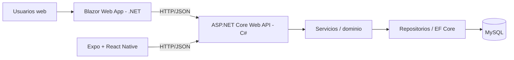

<p align="center">
  
</p>

# REPORTEROS | Documentación integral v2

> **REPORTEROS — Centro de información deportiva uruguaya**  
> Equipo: Juan Meny · Mateo Rilla · Facundo Villalba  
> **Stack confirmado por el equipo:** ASP.NET Core Web API (C#) · MySQL · Blazor Web App (.NET) · Expo + React Native (Expo Go) vía HTTP/JSON.
> Estado: monorepo base inicializado con .NET 10; persistencia y funcionalidades pendientes.

## Objetivo
REPORTEROS reúne la información del deporte uruguayo: **fútbol, básquetbol y esports**, con especial atención al ecosistema de AUDV cuando existan datos y permisos verificables. El nombre une **reporteros** y **teros** (ave nacional). Es una plataforma editorial e informativa, no una herramienta de inscripción de torneos.

## Arquitectura obligatoria del trabajo integrador

**Regla esencial:** Blazor y móvil **no consultan MySQL directamente**. Toda escritura, autorización, validación y regla de negocio reside detrás de la API. La API es el contrato estable entre materias. Blazor no debe replicar reglas del servidor.

## Decisiones cerradas y pendientes
| Elemento | Estado |
|---|---|
| Marca | REPORTEROS |
| Alcance temático | Fútbol, básquetbol, esports uruguayos |
| Backend | ASP.NET Core Web API en C# |
| Base de datos | MySQL |
| Aplicación web | Blazor Web App (componentes Razor `.razor`), consumidora HTTP de la API |
| Cliente móvil | Expo + React Native, validado en desarrollo con Expo Go; se implementará al final |
| ORM | EF Core + proveedor MySQL **propuesto**, sujeto a compatibilidad de versiones |
| Renderizado Blazor | Interactive Server |
| Auth | ASP.NET Core Identity / tokens o cookies según frontera, decisión por cerrar |
| Competiciones y proveedores de datos | Pendiente de selección y validación |

**Terminología:** en la conversación se indicó «Blazor Pages». La especificación adopta **Blazor Web App con páginas de componentes Razor**, no el framework separado **ASP.NET Core Razor Pages** (`.cshtml`). Confirmar este matiz con el profesor.

## Índice documental
- [OVERVIEW.md](docs/01-producto/OVERVIEW.md)
- [SCOPE.md](docs/01-producto/SCOPE.md)
- [STAKEHOLDERS.md](docs/01-producto/STAKEHOLDERS.md)
- [BUSINESS-RULES.md](docs/02-requisitos/BUSINESS-RULES.md)
- [REQUIREMENTS.md](docs/02-requisitos/REQUIREMENTS.md)
- [USER-STORIES.md](docs/02-requisitos/USER-STORIES.md)
- [DESIGN.md](docs/03-diseno/DESIGN.md)
- [INFORMATION-ARCHITECTURE.md](docs/03-diseno/INFORMATION-ARCHITECTURE.md)
- [API-CONTRACTS.md](docs/04-tecnica/API-CONTRACTS.md)
- [API.md](docs/04-tecnica/API.md)
- [ARCHITECTURE.md](docs/04-tecnica/ARCHITECTURE.md)
- [AUTHENTICATION.md](docs/04-tecnica/AUTHENTICATION.md)
- [BLAZOR.md](docs/04-tecnica/BLAZOR.md)
- [DATA-SOURCES.md](docs/04-tecnica/DATA-SOURCES.md)
- [DATABASE.md](docs/04-tecnica/DATABASE.md)
- [DEPLOYMENT.md](docs/04-tecnica/DEPLOYMENT.md)
- [MOBILE-INTEGRATION.md](docs/04-tecnica/MOBILE-INTEGRATION.md)
- [PROJECT-STRUCTURE.md](docs/04-tecnica/PROJECT-STRUCTURE.md)
- [SECURITY.md](docs/04-tecnica/SECURITY.md)
- [TECH-STACK.md](docs/04-tecnica/TECH-STACK.md)
- [QUALITY.md](docs/05-calidad/QUALITY.md)
- [TEST-PLAN.md](docs/05-calidad/TEST-PLAN.md)
- [DECISIONS.md](docs/06-gestion/DECISIONS.md)
- [RISKS.md](docs/06-gestion/RISKS.md)
- [ROADMAP.md](docs/06-gestion/ROADMAP.md)
- [TEAM-WORKFLOW.md](docs/06-gestion/TEAM-WORKFLOW.md)
- [BRANDING.md](docs/07-identidad/BRANDING.md)
- [MASTER-BRANDING-Y-PRODUCTO.md](docs/07-identidad/MASTER-BRANDING-Y-PRODUCTO.md)

## Estructura del monorepo

```text
Reporteros.sln
├── src/
│   ├── Reporteros.Api/     # HTTP, servicios, modelos y acceso a datos
│   └── Reporteros.Web/     # Blazor Web App; consume la API por HTTP
├── mobile/                 # Expo + React Native (última etapa)
├── docs/
└── assets/
```

La solución `.NET` contiene únicamente `Reporteros.Api` y `Reporteros.Web`. El cliente móvil no forma parte de `Reporteros.sln`; comparte exclusivamente el contrato HTTP/JSON.

## Desarrollo local

### Requisitos

- .NET SDK 10 (el rango compatible está fijado en `global.json`).
- Git.
- MySQL se incorporará al comenzar persistencia.

### Configuración de la base de datos (MySQL / Aiven)

La cadena de conexión **no se versiona** (ni User Secrets ni variables de entorno se commitean). Cada integrante debe configurar la suya una vez al clonar.

**Opción A — User Secrets (recomendada):**
```bash
cd src/Reporteros.Api
dotnet user-secrets set "ConnectionStrings:DefaultConnection" "Server=<HOST>;Port=<PORT>;Database=<DB>;User=<USER>;Password=<PASS>;SslMode=Required;"
```
Verificar con `dotnet user-secrets list`.

**Opción B — Variable de entorno:**
```bash
export ConnectionStrings__DefaultConnection="Server=<HOST>;Port=<PORT>;Database=<DB>;User=<USER>;Password=<PASS>;SslMode=Required;"
```

**Opción C — `appsettings.Development.json` local (no commitear):**
Crear `src/Reporteros.Api/appsettings.Development.json` (gitignored) con:
```json
{ "ConnectionStrings": { "DefaultConnection": "Server=...;...;SslMode=Required;" } }
```

Después de configurarla:
```bash
cd src/Reporteros.Api
dotnet ef database update   # crea tablas + seed de 3 deportes
dotnet run                  # levanta la API
curl http://localhost:5279/api/v1/deportes
```

> Si el equipo prefiere cero configuración al clonar, se puede commitear la cadena en `appsettings.Development.json`, pero eso expone las credenciales de Aiven en el repositorio (público). No recomendado.

### Restaurar y compilar

```bash
dotnet restore Reporteros.sln
dotnet build Reporteros.sln
```

### Ejecutar

En dos terminales:

```bash
dotnet run --project src/Reporteros.Api
dotnet run --project src/Reporteros.Web
```

| Servicio | HTTP | HTTPS |
|---|---|---|
| API | `http://localhost:5279` | `https://localhost:7045` |
| Web | `http://localhost:5188` | `https://localhost:7189` |

Comprobación rápida de la API:

```bash
curl http://localhost:5279/health
```

OpenAPI está disponible en desarrollo en `/openapi/v1.json`. La URL local que usa Blazor se configura mediante `Api:BaseUrl` en `src/Reporteros.Web/appsettings.json` y puede sobrescribirse por ambiente.

## Primer corte funcional (API-first)

Primero asentar la base de datos y la API con datos de prueba en abundancia; la Web se aborda recién cuando la API esté validada con un cliente HTTP independiente.

Secuencia:
1. Confirmar proveedor MySQL compatible y migración inicial (ADR-018).
2. Implementar vertical completa de competiciones en la API: controlador → servicio → repositorio → MySQL → DTO JSON → OpenAPI.
3. Cargar seed de datos de prueba abundante y representativo (3 disciplinas, resultados en borrador/aprobado/corregido, partido suspendido, serie BO3, standings con empate, noticia borrador).
4. Validar la API con cliente HTTP independiente (curl/Postman) y tests de integración (TC-API-01..07).
5. Recién entonces conectar `ReporterosApiClient` → componente Blazor y repetir el patrón para partidos, noticias y administración.

La Web no debe implementarse con datos hardcodeados ni consumir endpoints no estabilizados.

## Criterio de éxito transversal
Una corrección autorizada de resultado realizada por la API actualiza la información que obtiene Blazor y que obtendrá un cliente móvil, sin duplicar consultas SQL, validaciones ni fórmulas de posiciones en cada frontend.
