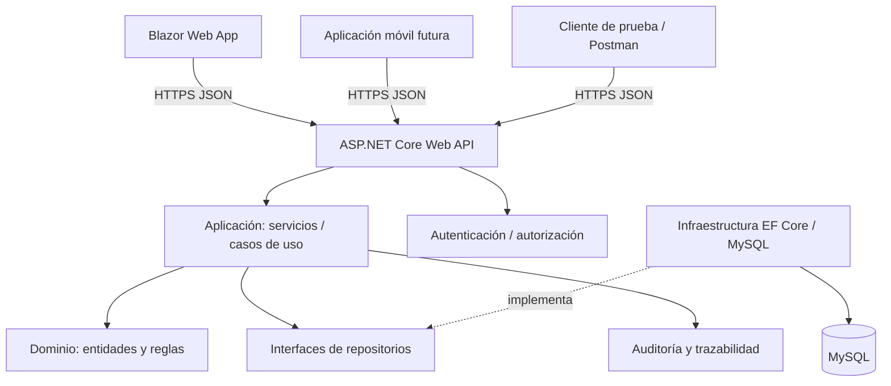

# ARCHITECTURE | Arquitectura API-first

> **REPORTEROS — Centro de información deportiva uruguaya**  
> Equipo: Juan Meny · Mateo Rilla · Facundo Villalba  
> **Stack confirmado por el equipo:** ASP.NET Core Web API (C#) · MySQL · Blazor Web App (.NET) · cliente móvil futuro vía HTTP/JSON.  
> Estado: especificación de trabajo; confirmar versión .NET y exigencias de la docencia.

## Principio rector
Un único backend ASP.NET Core concentra la lógica. Blazor es **un consumidor** de la API, al igual que la futura app móvil. Comparten datos, autorizaciones y decisiones de negocio.

## Módulos de dominio
1. Catálogo: deportes, videojuegos, competiciones, temporadas, equipos.
2. Partidos: agenda, estados, participantes, marcadores, confirmación y correcciones.
3. Clasificaciones: cálculo según reglamento de cada modalidad; sin forzar un criterio universal.
4. Editorial: noticias, borradores, revisión, publicación y procedencia.
5. Usuarios: roles, autorización y sesiones.
6. Fuentes: origen, fecha, fiabilidad declarada y responsable de carga.
7. Auditoría: acciones sensibles y versiones.

## Responsabilidades estrictas
| Proyecto | Puede | No puede |
|---|---|---|
| `Reporteros.Domain` | Entidades, value objects, invariantes puras | Referenciar ASP.NET, EF, Blazor |
| `Reporteros.Application` | Casos de uso y políticas de publicación | SQL, componentes UI |
| `Reporteros.Infrastructure` | Repositorios, MySQL, adaptadores, migraciones | Definir reglas de negocio en controladores |
| `Reporteros.Api` | HTTP, auth, mapeo DTO, status codes, OpenAPI | Contener toda la lógica o SQL ad hoc |
| `Reporteros.Contracts` | DTO públicos y esquemas de contrato | Exponer entidades persistentes / DbContext |
| `Reporteros.Web` | Rutas, componentes, cliente HTTP tipado, estados UI | Acceder a MySQL, calcular tablas oficiales |

## Escenario completo: publicación de resultado
1. Editor inicia sesión y registra marcador desde Blazor.
2. Blazor envía `PUT /api/v1/admin/matches/{id}/result` con token/cookie según diseño definitivo y `version`.
3. API valida autorización y estructura de entrada; Application comprueba coherencia y transición de estado.
4. Infrastructure actualiza MySQL y auditoría en **una transacción**.
5. API responde JSON con nuevo estado, versión y `updatedAt`.
6. Blazor vuelve a consultar `GET /api/v1/matches/{id}`; cualquier cliente móvil obtiene la misma información pública.
7. Posiciones se recalculan de resultados oficiales de manera definida; los borradores no afectan resultados visibles.

## Gestión de fallos
- API fuera de servicio: web muestra error recuperable, sin lectura directa de BD como atajo.
- MySQL fuera de servicio: API responde estado adecuado y registra fallo interno sin revelar credenciales.
- Token expirado: cliente reautentica; nunca conserva permisos de forma local como autoridad.
- Error de validación: `400/422`, `ProblemDetails` y errores por campo.
- Edición concurrente: `409 Conflict` con explicación y recarga de entidad.

## Integridad y transacciones
Los cambios en resultado y bitácora son atómicos; FK y unicidad en BD complementan las validaciones del dominio. Evitar microservicios, colas o actualización en vivo compleja para el MVP. La arquitectura es **monolito modular con API pública interna**.
