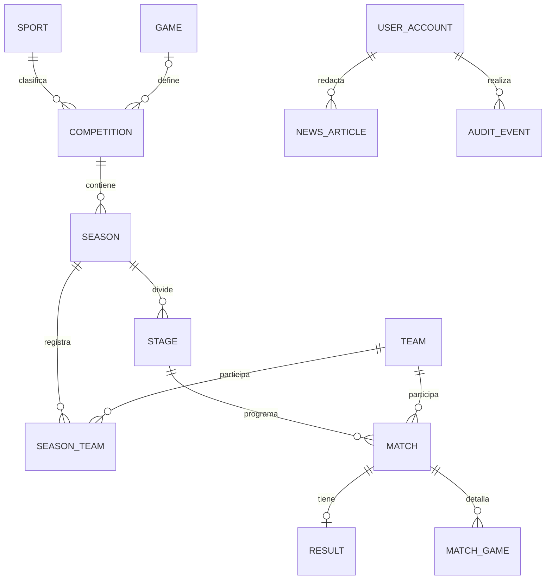

# DATABASE — Modelo relacional preliminar

> **REPORTEROS · Proyecto obligatorio · Equipo:** Juan Meny, Mateo Rilla y Facundo Villalba.  
> **Estado documental:** propuesta para validación académica. **Confirmado:** nombre REPORTEROS; plataforma deportiva uruguaya; fútbol, básquetbol y esports; enfoque informativo. **No confirmado:** stack definitivo, competiciones exactas, calendario, fuentes e instituciones asociadas.

## 1. Objetivo y límites
Proponer entidades normalizadas, PK/FK, unicidad, reglas y datos de ejemplo para MER/DER. El esquema final requiere elegir motor y formato de competiciones. **No es SQL ejecutable definitivo.**

## 2. Catálogo de entidades
| Tabla | Clave y campos | Relaciones/restricciones |
|---|---|---|
| `sport` | `id`, `code`, `name` | code único: football/basketball/esports |
| `game` | `id`, `name`, `slug` | solo para esports; slug único |
| `competition` | `id`, `sport_id`, `game_id?`, `name`, `slug`, `format`, `country` | FK sport; esports requiere game; slug contextual único |
| `season` | `id`, `competition_id`, `label`, `start_at?`, `end_at?`, `rules_json?`, `status` | combinación competencia+label única |
| `stage` | `id`, `season_id`, `name`, `kind`, `sort_order` | permite liga, grupos, playoffs |
| `team` | `id`, `name`, `slug`, `type`, `region?`, `logo_asset_id?` | slug contexto único |
| `season_team` | `season_id`, `team_id`, `seed?` | PK compuesta |
| `participant` | `id`, `display_name`, `external_ref?` | no exigir datos personales sensibles |
| `roster_membership` | `id`, `team_id`, `participant_id`, `from_at?`, `to_at?` | vigencia opcional |
| `match` | `id`, `stage_id`, `home_team_id`, `away_team_id`, `starts_at?`, `status`, `best_of?`, `version` | FKs, equipos distintos, estados válidos |
| `result` | `id`, `match_id`, `home_score`, `away_score`, `approval_status`, `approved_by?`, `approved_at?` | una versión activa por partido |
| `match_game` | `id`, `match_id`, `map_name?`, `sequence`, `home_score?`, `away_score?` | detalle esports opcional |
| `news_article` | `id`, `author_id`, `title`, `slug`, `summary`, `body`, `status`, `published_at?` | slug único, trazabilidad |
| `article_tag` | `article_id`, `tag_id` | PK compuesta |
| `tag` | `id`, `name`, `slug` | slug único |
| `source` | `id`, `name`, `url?`, `source_type`, `accessed_at?`, `license_note?` | fuente de evidencia |
| `source_link` | `id`, `source_id`, `entity_type`, `entity_id`, `note?` | evaluar integridad de vínculo polimórfico |
| `user_account` | `id`, `email`, `password_hash`, `active`, `created_at` | email normalizado único |
| `role` | `id`, `code` | admin/editor/reviewer |
| `user_role` | `user_id`, `role_id` | PK compuesta |
| `audit_event` | `id`, `actor_id`, `entity_type`, `entity_id`, `action`, `before_json`, `after_json`, `reason?`, `occurred_at` | inmutable desde UI |
| `media_asset` | `id`, `path`, `alt`, `credit`, `license`, `uploaded_by` | restringir publicación sin derechos |

## 3. MER simplificado

## 4. Normalización
1FN: un registro por equipo/temporada, sin arrays de equipos en cadena; 2FN: atributos de relación como seed en tabla intermedia; 3FN: nombre de disciplina solo en `sport`, no duplicarlo en `match`. Reglas de aplicación no reemplazan FK/unique/transaction DB.

## 5. Reglas de consistencia adicionales
- No guardar un marcador publicado sin sus dos valores y aprobador.
- `match.stage_id` determina temporada y competencia; validar que ambos equipos figuren en la temporada si aplica.
- Marcar `result` como histórico en lugar de sobrescribir sin auditoría; definir estrategia versionada al implementar.
- Esports: `best_of` impar positivo para modalidades sin empates, solo si está documentado.
- Evitar valores por defecto 0 en estadísticas desconocidas.

## 6. Consultas principales
Próximos partidos ordenados por `starts_at`; resultados finalizados por disciplina; clasificación agregada por equipo; artículos publicados por fecha; resultados sin fuente; eventos de auditoría por entidad; calendario de equipo.

## 7. Índices sugeridos
`match(stage_id,starts_at)`, `match(status,starts_at)`, `result(match_id,approval_status)`, `news_article(status,published_at)`, `audit_event(entity_type,entity_id,occurred_at)`, `season(competition_id,label)`.

## 8. Dataset de demo
1 competición sintética por disciplina; al menos 4 equipos en cada una; 6 encuentros de ejemplo por torneo, algunos programados y otros finalizados; 3 artículos; 1 resultado pendiente; 1 corrección auditada. Etiquetar claramente **datos de demostración** y evitar atribuir resultados a entidades reales.

## 9. Pendientes de diseño
Tabla de fases esports por brackets; categorías masculinas/femeninas/formativas si se cubren; sedes; participantes individuales; jurisdicción de slugs; regla de desempate por competición; esquema de fuente tipada (preferible a vínculo polimórfico en diseño definitivo).
