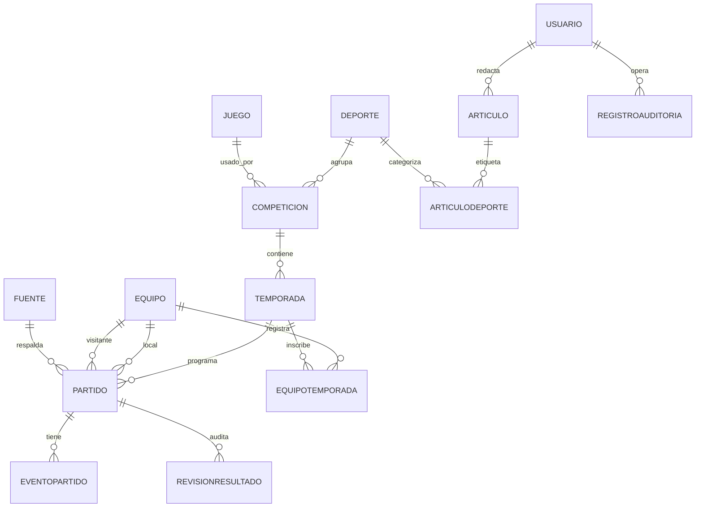

# DATABASE | Modelo relacional MySQL

> **REPORTEROS — Centro de información deportiva uruguaya**  
> Equipo: Juan Meny · Mateo Rilla · Facundo Villalba  
> **Stack confirmado por el equipo:** ASP.NET Core Web API (C#) · MySQL · Blazor Web App (.NET) · Expo + React Native (Expo Go) vía HTTP/JSON.
> Estado: especificación de trabajo; validar exigencias específicas con la docencia.

## 1. Propósito
MySQL es **la única base de datos operativa** para API, web y futuro móvil. Las aplicaciones cliente no gestionan su propia copia autoritativa. La persistencia se encapsula en Infrastructure.

## 2. Diagrama conceptual

## 3. Entidades iniciales
| Tabla | Campos clave | Restricciones/notas |
|---|---|---|
| `deportes` | id, slug, nombre, tipo | tipo: tradicional/esports; slug único |
| `juegos` | id, slug, nombre | Solo para esports; slug único |
| `competiciones` | id, deporte_id, juego_id?, nombre, ambito, formato | juego_id requerido para ciertas competiciones esports |
| `temporadas` | id, competicion_id, etiqueta, inicio, fin, estado, reglas_json? | Vigencia y reglamento por temporada |
| `equipos` | id, nombre, slug, region?, url_logo? | Datos mínimos; no falsificar identidades |
| `equipos_temporada` | id, temporada_id, equipo_id | índice único `(temporada_id,equipo_id)` |
| `partidos` | id, temporada_id, equipo_local_id, equipo_visitante_id, programado_en, estado, puntos_local?, puntos_visitante?, mejor_de?, fuente_id?, version, publicado_en?, actualizado_en | Reglas específicas y claves externas |
| `eventos_partido` | id, partido_id, tipo_evento, minuto_o_ronda?, metadatos_json? | Tipo válido según deporte |
| `revisiones_resultado` | id, partido_id, editor_usuario_id, anterior_json, nuevo_json, motivo, cambiado_en | Historial inmutable salvo política de retención |
| `fuentes` | id, titulo, url?, capturado_en?, confianza?, atribucion | Distinguir fuente verificada vs carga manual |
| `articulos` | id, autor_usuario_id, slug, titulo, resumen, cuerpo, estado, publicado_en?, actualizado_en | No publicar borradores |
| `articulos_deporte` | articulo_id, deporte_id | PK compuesta |
| `usuarios` / roles | esquema gestionado por identidad elegida | No guardar password en texto plano |
| `registros_auditoria` | id, actor_usuario_id, accion, tipo_entidad, entidad_id, ocurrido_en, detalles_json | No incluir secretos ni información sensible innecesaria |

## 4. Reglas relacionales críticas
- Equipo local y visitante no pueden coincidir. Los dos deben estar habilitados en la temporada, salvo formato especial documentado.
- La puntuación solo admite valores no negativos y no nulos cuando se publica el resultado final.
- Un partido `finalizado` no pasa a otro marcador sin corrección justificada, autorización, control de versión y auditoría.
- `unique(slug)` donde corresponda; índices `(season_id, scheduled_at)`, `(status, published_at)`, `(competition_id, start_at)`; FK con `ON DELETE RESTRICT` cuando hay historial.
- `version` entero monotónico para concurrencia optimista; incrementarlo atómicamente cuando haya edición válida.
- Temporadas y reglas pueden condicionar clasificaciones distintas entre fútbol, básquetbol y esports; **no** usar puntos fijos por defecto para los tres.

## 5. Decisiones de tipos y fechas
Usar `utf8mb4` y collation acordada; `BIGINT` o `CHAR(36)` para IDs según preferencia del curso, de manera uniforme; `DATETIME(6)` en UTC acompañado de contrato claro de zona. MySQL no guarda automáticamente la zona en `DATETIME`, por lo que la convención UTC es explícita. Para JSON flexible usar columnas JSON solo donde no convenga modelar una relación estable.

## 6. ORM / migraciones
EF Core + proveedor MySQL es sugerencia; comprobar compatibilidad concreta con la versión de .NET/EF. Aplicar migraciones versionadas de forma reproducible, sin editar tablas manualmente en producción. Semilla con equipos y competencias **ficticios claramente identificados** para demo.

## 7. Operaciones transaccionales
Publicar resultado: verificar versión + modificar partido + insertar `result_revisions` + `audit_logs` dentro de transacción. Si falla cualquiera, revertir todo. No permitir que Blazor llame a `DbContext`.

## 8. Consultas/reportes
Agenda por deporte y fecha, partidos por temporada, clasificaciones derivadas de resultados aprobados, noticias por fecha, pendientes de revisión, historial de correcciones. Priorizar índices y paginación. La tabla de posiciones es vista calculada/servicio de dominio, no un dato editado arbitrariamente.

## 9. DDL y DER finales
El diagrama es **preliminar**, no una migración ejecutada. Confirmar con profesor detalles de participantes individuales, género/categorías, fixture, esports al mejor de N y reglas de desempate antes de cerrar DDL.
