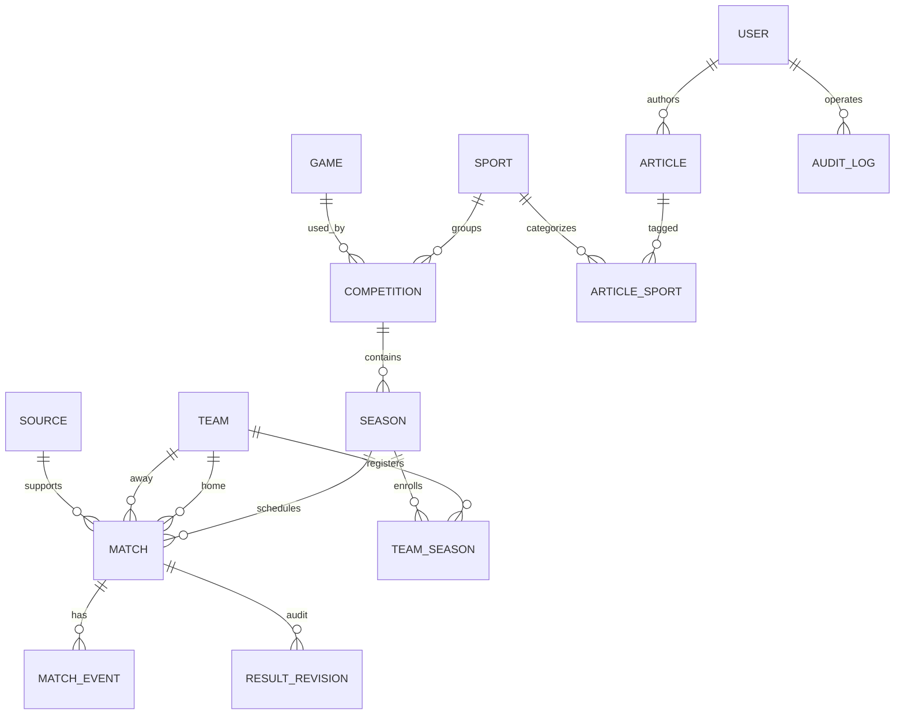

# DATABASE | Modelo relacional MySQL

> **REPORTEROS — Centro de información deportiva uruguaya**  
> Equipo: Juan Meny · Mateo Rilla · Facundo Villalba  
> **Stack confirmado por el equipo:** ASP.NET Core Web API (C#) · MySQL · Blazor Web App (.NET) · cliente móvil futuro vía HTTP/JSON.  
> Estado: especificación de trabajo; confirmar versión .NET y exigencias de la docencia.

## 1. Propósito
MySQL es **la única base de datos operativa** para API, web y futuro móvil. Las aplicaciones cliente no gestionan su propia copia autoritativa. La persistencia se encapsula en Infrastructure.

## 2. Diagrama conceptual

## 3. Entidades iniciales
| Tabla | Campos clave | Restricciones/notas |
|---|---|---|
| `sports` | id, slug, name, kind | kind: traditional/esports; slug único |
| `games` | id, slug, name | Solo para esports; slug único |
| `competitions` | id, sport_id, game_id?, name, scope, format | game_id requerido para ciertas competencias esports |
| `seasons` | id, competition_id, label, start_at, end_at, status, rules_json? | Vigencia y reglamento por temporada |
| `teams` | id, name, slug, region?, logo_url? | Datos mínimos; no falsificar identidades |
| `team_seasons` | id, season_id, team_id | índice único `(season_id,team_id)` |
| `matches` | id, season_id, home_team_id, away_team_id, scheduled_at, status, home_score?, away_score?, best_of?, source_id?, version, published_at?, updated_at | Reglas específicas y claves externas |
| `match_events` | id, match_id, event_type, minute_or_round?, metadata_json? | Tipo válido según deporte |
| `result_revisions` | id, match_id, editor_user_id, previous_json, new_json, reason, changed_at | Historial inmutable salvo política de retención |
| `sources` | id, title, url?, captured_at?, confidence?, attribution | Distinguir fuente verificada vs carga manual |
| `articles` | id, author_user_id, slug, title, summary, body, status, published_at?, updated_at | No publicar borradores |
| `article_sports` | article_id, sport_id | PK compuesta |
| `users` / roles | esquema gestionado por identidad elegida | No guardar password en texto plano |
| `audit_logs` | id, actor_user_id, action, entity_type, entity_id, occurred_at, details_json | No incluir secretos ni información sensible innecesaria |

## 4. Reglas relacionales críticas
- Equipo local y visitante no pueden coincidir. Los dos deben estar habilitados en la temporada, salvo formato especial documentado.
- La puntuación solo admite valores no negativos y no nulos cuando se publica el resultado final.
- Un partido `finalizado` no pasa a otro marcador sin corrección justificada, autorización, control de versión y auditoría.
- `unique(slug)` donde corresponda; índices `(season_id, scheduled_at)`, `(status, published_at)`, `(competition_id, start_at)`; FK con `ON DELETE RESTRICT` cuando hay historial.
- `version` entero monotónico para concurrencia optimista; incrementarlo atómicamente cuando haya edición válida.
- Temporadas y reglas pueden condicionar clasificaciones distintas entre fútbol, básquetbol y esports; **no** usar puntos fijos por defecto para los tres.

## 5. Decisiones de tipos y fechas
Usar `utf8mb4` y collation acordada; `BIGINT` o `CHAR(36)` para IDs según preferencia del curso, de manera uniforme; `DATETIME(6)` en UTC acompañado de contrato claro de zona. MySQL no guarda automáticamente la zona en `DATETIME`, por lo que la convención UTC es explícita. Para JSON flexible usar columnas JSON solo donde no convenga modelar una relación estable.

## 6. ORM / migraciones
EF Core + proveedor MySQL es sugerencia; comprobar compatibilidad concreta con la versión de .NET/EF. Aplicar migraciones versionadas de forma reproducible, sin editar tablas manualmente en producción. Semilla con equipos y competencias **ficticios claramente identificados** para demo.

## 7. Operaciones transaccionales
Publicar resultado: verificar versión + modificar partido + insertar `result_revisions` + `audit_logs` dentro de transacción. Si falla cualquiera, revertir todo. No permitir que Blazor llame a `DbContext`.

## 8. Consultas/reportes
Agenda por deporte y fecha, partidos por temporada, clasificaciones derivadas de resultados aprobados, noticias por fecha, pendientes de revisión, historial de correcciones. Priorizar índices y paginación. La tabla de posiciones es vista calculada/servicio de dominio, no un dato editado arbitrariamente.

## 9. DDL y DER finales
El diagrama es **preliminar**, no una migración ejecutada. Confirmar con profesor detalles de participantes individuales, género/categorías, fixture, esports al mejor de N y reglas de desempate antes de cerrar DDL.
