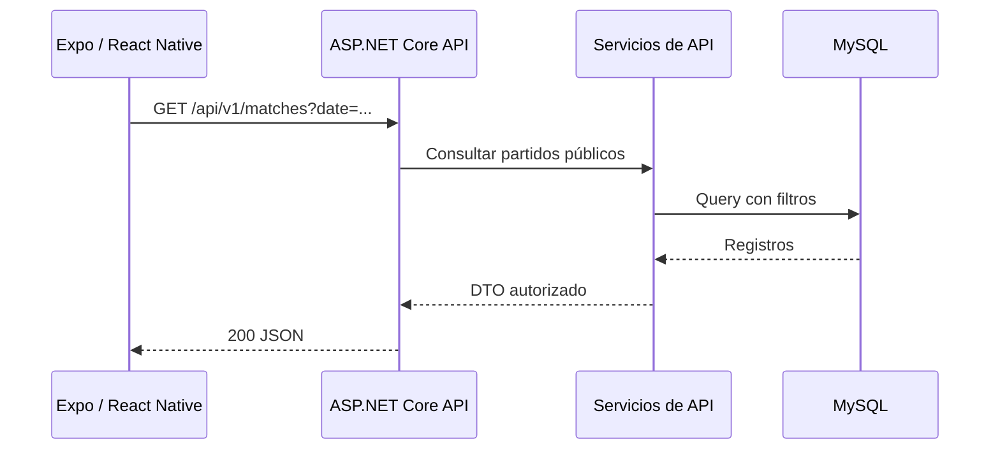

# MOBILE-INTEGRATION | Integración entre materias

> **REPORTEROS — Centro de información deportiva uruguaya**  
> Equipo: Juan Meny · Mateo Rilla · Facundo Villalba  
> **Stack confirmado por el equipo:** ASP.NET Core Web API (C#) · MySQL · Blazor Web App (.NET) · Expo + React Native (Expo Go) vía HTTP/JSON.
> Estado: especificación de trabajo; validar exigencias específicas con la docencia.

## 1. Objetivo académico
En Desarrollo Móvil se creará un cliente con **Expo + React Native**, validado durante desarrollo mediante Expo Go. Consumirá **la misma ASP.NET Core Web API** y **la misma base MySQL indirectamente**; no duplicará lógica ni tablas. La app móvil se implementará después de consolidar API y Web y **no forma parte del MVP web comprometido**, salvo indicación docente posterior.

## 2. Requisitos de preparación desde hoy
- Prefijo de versión estable y OpenAPI exportable.
- URLs de producción/prueba configurables y HTTPS.
- JSON documentado, enums explícitos, paginación y fechas ISO-8601.
- Sin cookies de navegador como única opción de autenticación del ecosistema; diseñar esquema apto para clientes móviles si requieren login.
- `401/403/409/429` consistentes, errores sin HTML en API.
- Evitar que reglas estén en UI; el móvil solo presenta datos y envía comandos autorizados.

## 3. Contrato móvil mínimo
MVP móvil futuro: inicio público, filtro por deporte, lista de partidos, detalle de partido, noticias, detalle de noticia. Extensiones: favoritos locales, notificaciones, autenticación, administración restringida. Cada pantalla se mapea a endpoint existente; no abrir acceso SQL.

## 4. Sincronización
El origen es servidor central. Móvil puede cachear resultados públicos con fecha de actualización; cuando vuelve a tener red, solicita datos nuevos. Resolver datos obsoletos por versión y refresco, no hacer escrituras offline críticas en MVP. Se admiten caches locales **no autoritativas**.

## 5. Prueba de independencia
Con la API desplegada, ejecutar peticiones con navegador web y un segundo cliente (curl o Postman). Deben coincidir el ID, estado y marcador del mismo encuentro. Si se corrige el resultado desde administrador, ambos reciben el nuevo valor.

## 6. Riesgos
CORS afecta principalmente a clientes web basados en navegador, no suele impedir solicitudes nativas; no sustituye auth. El entorno móvil necesitará una URL accesible desde el dispositivo (no `localhost` del PC), certificados válidos y política de almacenamiento seguro de credenciales.
